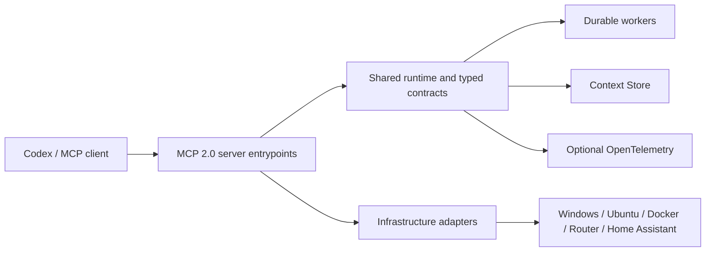

# MCP Control Plane

[](https://github.com/albertik322-sudo/mcp-control-plane/actions/workflows/mcp-ci.yml)

Open-source, Windows-first control plane for operating local and homelab services
through typed [Model Context Protocol](https://modelcontextprotocol.io/) servers.

The repository combines MCP 2.0 stateless servers, durable worker orchestration,
Context Store memory, security-aware infrastructure adapters, Agent Skills, and
optional OpenTelemetry export.

## Highlights

- 13 MCP servers and 290 narrowly scoped tools.
- JSON Schema 2020-12 output contracts and structured tool results.
- MCP Apps support with a text fallback for hosts without embedded UI.
- Durable internal Tasks pilot with explicit wire-capability detection.
- Windows, Ubuntu, Docker, MikroTik, Home Assistant, observability, mail,
  Steam Deck, and ComfyUI integrations.
- Stateless MCP conformance suite and offline Windows CI.
- Project-scoped MCP security and control-plane audit skills.

## Architecture



Entrypoints remain at the repository root because Codex configuration and local
automation reference those paths directly. Shared behavior lives in:

- `mcp_runtime.py` — server factory and middleware wiring.
- `mcp_contracts.py` — closed typed output models.
- `mcp_extensions.py` — MCP Apps and durable Tasks pilot.
- `mcp_observability.py` — opt-in telemetry configuration.
- `codex_workers.py` and `workers_mcp.py` — bounded parallel execution.
- `codex_memory.py` and `memory_mcp.py` — durable Context Store.

See [Architecture](docs/architecture.md) for the subsystem map.

## Quick start

Requirements:

- Windows 11 or Windows Server
- Python 3.12
- PowerShell 7 recommended
- GitHub CLI for Agent Skill management

```powershell
python -m venv .venv
.\.venv\Scripts\python.exe -m pip install -r requirements.txt
Copy-Item .env.example .env
```

Edit `.env` locally. Never commit it. Start an individual server with:

```powershell
.\.venv\Scripts\python.exe workers_mcp.py
```

Use [`config.example.toml`](config.example.toml) as a registration template and
copy only the servers you need into the Codex MCP configuration. Long-lived MCP
processes must be restarted after code or dependency changes.

## Validation

```powershell
.\.venv\Scripts\python.exe -m pip install -r requirements-dev.txt
.\.venv\Scripts\python.exe -m pytest
.\.venv\Scripts\python.exe skills\mcp-control-plane-audit\scripts\audit_control_plane.py --root . --fail-on medium
powershell -NoProfile -ExecutionPolicy Bypass -File .\scripts\run_mcp_conformance.ps1
```

Live infrastructure smoke tests are opt-in and are skipped in normal CI.

## Agent Skills

Install the repository-owned audit skill project-scoped:

```powershell
gh skill install . mcp-control-plane-audit --from-local --agent codex --scope project
```

Remote skills should be reviewed and installed at an immutable commit:

```powershell
gh skill preview OWNER/REPO PATH@COMMIT
gh skill install OWNER/REPO PATH --agent codex --scope project --pin COMMIT
```

## Security

This repository contains control-plane code, not credentials. Runtime secrets
belong in `.env`, the OS credential store, or a dedicated secret manager.
Mutation tools must enforce authorization inside the MCP/API implementation;
agent prompts and UI confirmations are not security boundaries.

Read [SECURITY.md](SECURITY.md) before connecting production infrastructure.

## Repository scope

Large captures, firmware, generated artifacts, operational snapshots, vendored
tools, local databases, private keys, and runtime state are intentionally
excluded. Security Session Gate, Shadow RDP Console, branding assets, and
firmware research are maintained as separate projects.

## License

Released under the permissive [MIT License](LICENSE).
